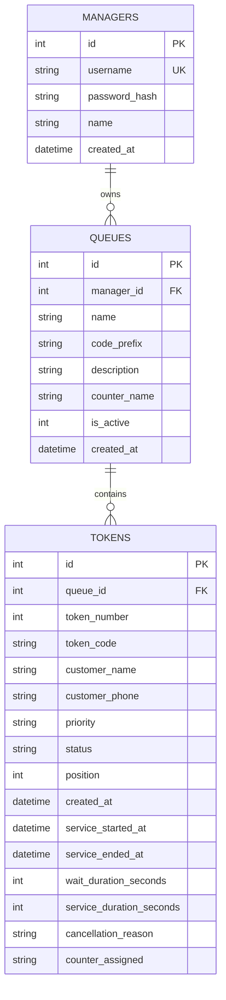
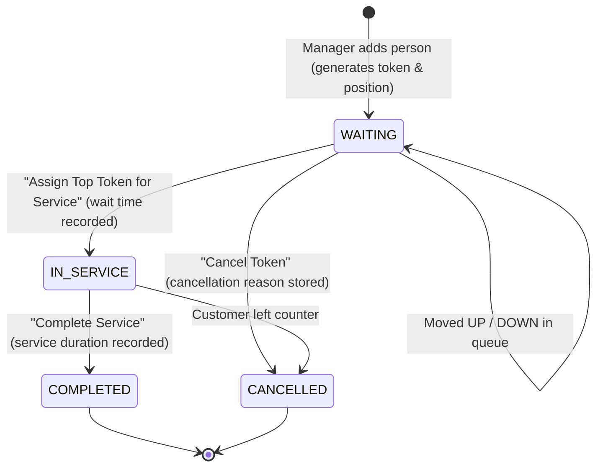

# 🚀 QueueFlow — Intelligent Real-Time Queue Management System

A full-stack, real-time queue management and operational dispatch platform built with **React 18**, **Tailwind CSS**, **Node.js (Express)**, **Native SQLite (`node:sqlite`)**, and **Socket.IO**.

Includes automated token dispatching, drag-and-drop / arrow reordering, audio voice announcements, a live airport/clinic-style TV Kiosk display, and an analytics dashboard with wait-time trends.

---

## 📋 Features Checklist (Requirements Mapping)

| # | Requirement | Implementation in QueueFlow | Status |
|---|-------------|-----------------------------|:------:|
| 1 | **Queue Manager Authentication** | JWT authentication with bcrypt password hashing; Register, Login, and **1-Click Demo Login** (`admin` / `admin123`). | ✅ Complete |
| 2 | **Queue Creation with Name** | Managers can create multiple queues with Name, unique Code Prefix (e.g., `SUP`, `BIL`, `VIP`), Desk/Counter name, and Description. | ✅ Complete |
| 3 | **Add Persons & Generate Tokens** | Modal to register person with Name, optional Phone, and Priority (`NORMAL`, `PRIORITY`, `VIP`). Generates unique sequential tokens (e.g. `SUP-001`). | ✅ Complete |
| 4 | **Display Waiting Tokens** | Interactive queue board with position badges (`#1 NEXT`, `#2`, `#3`), token codes, customer details, and a dynamic real-time wait ticker (`3m 42s`). | ✅ Complete |
| 5 | **Move Tokens Up & Down** | Move Up (`⬆️`) and Move Down (`⬇️`) buttons with atomic position swaps and automatic gap compaction. | ✅ Complete |
| 6 | **1-Click Top Token Service** | Prominent **"Assign Top Token for Service"** button. Moves top token to `IN_SERVICE`, triggers Web Speech voice announcement, records wait time, and starts live service timer. | ✅ Complete |
| 7 | **Cancel Tokens** | Cancel button with reason selection modal (`No-show`, `Left queue`, `Duplicate`, etc.). Automatically re-compacts remaining queue positions. | ✅ Complete |
| 8 | **Analytics Dashboard** | Charts for hourly arrival trends, queue comparison, token status breakdown, average wait time (minutes), average service time, and dropoff rate. | ✅ Complete |
| + | **Public TV Display (Kiosk Mode)** | Fullscreen monitor mode for waiting rooms showing **"NOW SERVING"** in giant glowing text + **"NEXT IN LINE"** list. | 🌟 Extra Feature |
| + | **Voice Audio Announcements** | Web Speech API + Web Audio chime calls tokens aloud: *"Attention please: Token S-U-P 0 0 1, please proceed to Desk 1"*. | 🌟 Extra Feature |

---

## 🏗️ System Architecture

```mermaid
flowchart TD
    subgraph Frontend ["Frontend (React 18 + Vite + Tailwind CSS)"]
        UI[Manager Dashboard & Operations]
        Analytics[Analytics Dashboard - Recharts]
        Kiosk[Public TV Display / Kiosk View]
        Voice[Web Speech & Audio Chime Service]
        SocketClient[Socket.IO Client]
    end

    subgraph Backend ["Backend (Node.js + Express)"]
        Server[Express HTTP Server :5000]
        AuthRoute[/api/auth - JWT & Bcrypt]
        QueueRoute[/api/queues - Queue Management]
        TokenRoute[/api/tokens - Dispatch & Reorder]
        AnalyticsRoute[/api/analytics - Metrics & Aggregations]
        WSServer[Socket.IO Realtime Gateway]
    end

    subgraph Storage ["Database (Native node:sqlite)"]
        DB[(queueflow.sqlite)]
    end

    UI --> Server
    Analytics --> Server
    Kiosk --> Server
    SocketClient <--> WSServer
    WSServer --> UI
    WSServer --> Kiosk
    Server --> DB
    WSServer --> Voice
```

---

## ⚡ Quick Start Guide

### Prerequisites
- **Node.js**: v20+ or v24+ (uses native `node:sqlite` for zero native build errors)
- **npm**: v9+

### 1. Installation
Clone the repository and install dependencies:
```bash
# Clone repository
git clone https://github.com/yourusername/queueflow.git
cd queueflow

# Install backend dependencies
cd server
npm install
cd ..

# Install frontend dependencies
cd client
npm install
cd ..
```

### 2. Run the Application
You can run the application in two ways:

#### Option A: Production Single-Port Mode (Recommended for testing)
```bash
# 1. Build the frontend client
npm run build

# 2. Start the fullstack server on http://localhost:5000
npm start
```
Now open your browser to **`http://localhost:5000`**.

#### Option B: Development Mode (Hot-Reloading)
```bash
npm run dev
```
- Frontend: `http://localhost:5173`
- Backend API & WebSockets: `http://localhost:5000`

---

## 🔑 Demo Account Credentials

For instant evaluation, a pre-configured demo account and seeded queues/tokens are ready on startup:

- **Username**: `admin`
- **Password**: `admin123`
- Or simply click the **"⚡ Quick 1-Click Demo Login"** button on the login screen!

---

## 🧪 Automated Test Suite

An automated end-to-end verification suite is included in `server/test-suite.js`. It validates all 8 requirements against the running server:

```bash
npm test
```

### Test Output Preview:
```text
🧪 Starting Full-Stack QueueFlow End-to-End Verification Suite...
1️⃣ Testing Authentication (Login as Manager)...  ✅ Logged in
2️⃣ Testing Queue Creation (Name & Prefix)...    ✅ Queue created: "Express Diagnostic Clinic"
3️⃣ Testing Adding Persons / Generating Tokens... ✅ Added Tokens 1, 2, 3
4️⃣ Testing Queue Display (Waiting List)...      ✅ Displays 3 waiting tokens in order
5️⃣ Testing Token Reordering (Move UP / DOWN)...  ✅ Tokens swapped and verified
6️⃣ Testing Assigning Top Token for Service...   ✅ Top Token IN_SERVICE with 1-click
7️⃣ Testing Token Cancellation...                ✅ Cancelled and recompacted
8️⃣ Testing Analytics Dashboard...               ✅ Wait times, Hourly trends computed
9️⃣ Testing Public Kiosk / TV Display...         ✅ Public TV monitor loaded
🔟 Testing Static Frontend Delivery...           ✅ Root URL serves production build
🎉 ALL 10 VERIFICATION TESTS PASSED WITH 100% SUCCESS!
```

---

## 📊 Database Schema & Token Lifecycle

### Entity-Relationship Diagram



### Token Lifecycle State Machine



---

## 🎙️ Technical Interview Q&A (Project Deep-Dive)

### 1. Why SQLite with native `node:sqlite`?
- **Zero build issues**: Standard `better-sqlite3` or `sqlite3` packages rely on `node-gyp` and Python C++ compilation toolchains, which frequently fail across varying OS environments. Node.js 22+ introduces official built-in synchronous SQLite (`node:sqlite` `DatabaseSync`), ensuring zero-dependency, bulletproof reliability across all platforms.
- **ACID Transactions**: Token swaps and position compactions execute synchronously and atomically within single database transactions, eliminating race conditions when multiple operators dispatch tokens simultaneously.

### 2. How does the Token Reordering (Move Up / Down) work?
When a manager clicks "Move Up" on a token with position $k$ ($k > 1$):
1. The backend locates the token currently sitting at position $k - 1$.
2. In an atomic transaction, the positions of both tokens are swapped: token $A$ becomes $k - 1$ and token $B$ becomes $k$.
3. If an anomaly or gap exists, a compaction subroutine (`compactQueuePositions`) normalizes positions strictly to $1 \dots N$.
4. Socket.IO broadcasts a `TOKEN_MOVED` event so all connected screens instantly re-render without page refresh.

### 3. How are Wait Times and Analytics calculated?
- **Wait Duration**: Measured as the difference between `created_at` (token issuance) and `service_started_at` (assignment to counter).
  $$\text{Wait Duration (sec)} = \text{service\_started\_at} - \text{created\_at}$$
- **Service Duration**: Measured as the duration between `service_started_at` and `service_ended_at` when the manager marks service completed.
- **Hourly Queue Trends**: SQL `strftime('%H:00', created_at)` aggregates arrivals and completed services by hour, feeding Recharts area charts to identify peak operating times.
- **Dropoff Rate**:
  $$\text{Cancellation Rate} = \frac{\text{Total Cancelled}}{\text{Completed} + \text{Cancelled}} \times 100\%$$

### 4. How does the Real-Time Sync work?
Socket.IO rooms are keyed by `queue_{queueId}`. Whenever an action occurs (`TOKEN_ADDED`, `TOKEN_MOVED`, `TOKEN_SERVED`, `TOKEN_COMPLETED`, `TOKEN_CANCELLED`), an event is emitted to that room. Both the Manager view and the public TV display listen to this event and trigger reactive state refreshes.

---

## 📂 Project Structure

```text
RAGUV/
├── package.json                 # Root unified script runner
├── start-dev.js                 # Dev concurrent launcher
├── .gitignore                   # Git ignore rules
├── README.md                    # Comprehensive documentation
├── server/
│   ├── package.json             # Server dependencies (Express, Socket.io, JWT, bcrypt)
│   ├── test-suite.js            # Automated E2E verification tests
│   ├── .env                     # Server environment config
│   ├── data/
│   │   └── queueflow.sqlite     # SQLite database
│   └── src/
│       ├── server.js            # Main Express & Socket.io server
│       ├── socket.js            # WebSocket rooms & emitters
│       ├── db/
│       │   ├── database.js      # Native node:sqlite schema & indexes
│       │   └── seed.js          # Demo manager, queues, and tokens seeder
│       ├── middleware/
│       │   └── auth.js          # JWT authentication middleware
│       └── routes/
│           ├── auth.js          # Register, Login, Demo Login, Me
│           ├── queues.js        # Queue CRUD & Public display
│           ├── tokens.js        # Add, Move Up/Down, Serve, Complete, Cancel
│           └── analytics.js     # Wait times, Hourly trends, Breakdown
└── client/
    ├── package.json             # Client dependencies (React 18, Tailwind, Lucide, Recharts)
    ├── vite.config.js           # Vite config with API & WebSocket proxy
    ├── tailwind.config.js       # Tailwind CSS theme & animations
    ├── index.html               # Web entrance with typography
    └── src/
        ├── App.jsx              # Main application coordinator
        ├── main.jsx             # React entry with AuthProvider
        ├── index.css            # Tailwind directives and custom scrollbar
        ├── context/
        │   └── AuthContext.jsx  # Authentication state & handlers
        ├── services/
        │   ├── api.js           # REST API client
        │   ├── socket.js        # Socket.io connection & rooms
        │   └── voice.js         # Web Speech & Audio chime synthesizer
        └── components/
            ├── Navbar.jsx               # Header & tab switcher
            ├── LoginModal.jsx           # Sign in, register & 1-click demo
            ├── QueueSidebar.jsx         # Queue list & selector
            ├── ActiveServingCard.jsx    # In-service card with live timer
            ├── WaitingQueueList.jsx     # Waiting list with move arrows
            ├── AddTokenModal.jsx        # Token generator modal
            ├── CreateQueueModal.jsx     # Queue creation modal
            ├── CancelTokenModal.jsx     # Cancellation reason modal
            ├── RecentHistoryTable.jsx   # Completed/Cancelled log
            ├── AnalyticsDashboard.jsx   # Recharts charts & KPI cards
            └── PublicDisplayModal.jsx   # Fullscreen TV monitor
```

---

## 📄 License
MIT License. Built for high-reliability queue management and operations dispatch.
