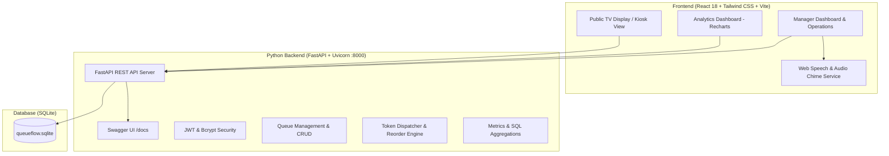

# 🚀 QueueFlow — Intelligent Full-Stack Queue Management System

A production-grade, full-stack queue management and operational dispatch platform built specifically for **Full-Stack Developer Roles**, featuring **Python (FastAPI)**, **React 18**, **Tailwind CSS**, **SQLite**, and interactive **OpenAPI/Swagger** documentation.

Includes automated token dispatching, drag-and-drop / arrow reordering, audio voice announcements, a live airport/clinic-style TV Kiosk display, and an analytics dashboard with wait-time trends.

---

## 🛠️ Full-Stack Technology Stack

| Domain | Language / Framework | Description & Key Libraries |
|---|---|---|
| **Backend (Python)** | **Python 3.13 + FastAPI** | High-performance asynchronous REST API, Pydantic v2 schemas, JWT authentication, Uvicorn ASGI server. |
| **Interactive API Docs**| **Swagger UI / OpenAPI** | Auto-generated interactive API documentation at `http://localhost:8000/docs`. |
| **Frontend** | **React 18 (JavaScript / JSX)** | Component-driven reactive UI, custom hooks, real-time sync, and mobile-first responsive design. |
| **Styling & Design** | **Tailwind CSS (v3)** | Modern responsive dark theme, glassmorphism cards, micro-animations, and touch-optimized controls. |
| **Database** | **SQLite + SQL** | ACID-compliant relational storage, sequential token generator, atomic position swaps, and analytical aggregations. |
| **Data Visualization** | **Recharts** | Interactive charts for wait times, hourly queue trends, and status breakdown. |
| **Voice & Audio** | **Web Speech API & Web Audio** | Native in-browser Text-to-Speech token callouts accompanied by a custom harmonic chime. |
| **Alternative Backend** | **Node.js (Express) + Socket.IO** | Dual backend option with WebSockets for real-time bidirectional push updates. |

---

## 📋 Features Checklist (Requirements Mapping)

| # | Requirement | Implementation in QueueFlow | Status |
|---|-------------|-----------------------------|:------:|
| 1 | **Queue Manager Authentication** | JWT authentication with bcrypt password hashing; Register, Login, and **1-Click Demo Login** (`admin` / `admin123`). | ✅ Complete |
| 2 | **Queue Creation with Name** | Managers can create multiple queues with Name, unique Code Prefix (e.g., `SUP`, `BIL`, `VIP`), Desk/Counter name, and Description. | ✅ Complete |
| 3 | **Add Persons & Generate Tokens** | Modal to register person with Name, optional Phone, and Priority (`NORMAL`, `PRIORITY`, `VIP`). Generates unique sequential tokens (e.g. `SUP-001`). | ✅ Complete |
| 4 | **Display Waiting Tokens** | Interactive queue board with position badges (`#1 NEXT`, `#2`, `#3`), token codes, customer details, and a dynamic real-time wait ticker (`3m 42s`). | ✅ Complete |
| 5 | **Move Tokens Up & Down** | Move Up (`⬆️`) and Move Down (`⬇️`) buttons with atomic position swaps and automatic gap compaction. | ✅ Complete |
| 6 | **1-Click Top Token Service** | Prominent **"Assign Top Token for Service"** button. Moves top token to `IN_SERVICE`, triggers Web Speech voice announcement, records wait time, and starts live service timer. | ✅ Complete |
| 7 | **Cancel Tokens** | Cancel button with reason selection modal (`No-show`, `Left queue`, `Duplicate`, etc.). Automatically re-compacts remaining queue positions. | ✅ Complete |
| 8 | **Analytics Dashboard** | Charts for hourly arrival trends, queue comparison, token status breakdown, average wait time (minutes), average service time, and dropoff rate. | ✅ Complete |
| + | **Public TV Display (Kiosk Mode)** | Fullscreen monitor mode for waiting rooms showing **"NOW SERVING"** in giant glowing text + **"NEXT IN LINE"** list. | 🌟 Extra Feature |
| + | **Voice Audio Announcements** | Web Speech API + Web Audio chime calls tokens aloud: *"Attention please: Token S-U-P 0 0 1, please proceed to Desk 1"*. | 🌟 Extra Feature |
| + | **Interactive Swagger Docs** | Interactive OpenAPI testing explorer at `http://localhost:8000/docs`. | 🌟 Extra Feature |

---

## 🏗️ System Architecture



---

## ⚡ Quick Start Guide (Python Backend)

### 1. Install Python Dependencies
```bash
pip install -r server_python/requirements.txt
```

### 2. Start Python FastAPI Backend
```bash
python server_python/main.py
```
- **Application URL**: `http://localhost:8000` (serves fullstack React app + API)
- **Interactive Swagger Docs**: `http://localhost:8000/docs`

---

## 🔑 Demo Account Credentials

For instant evaluation, a pre-configured demo account and seeded queues/tokens are ready on startup:

- **Username**: `admin`
- **Password**: `admin123`
- Or simply click the **"⚡ Quick 1-Click Demo Login"** button on the login screen!

---

## 🌐 Live GitHub Pages & Repository

- **Live Web Application**: **[https://nagellabalaji.github.io/queueflow-/](https://nagellabalaji.github.io/queueflow-/)**
- **GitHub Repository**: **[https://github.com/nagellabalaji/queueflow-](https://github.com/nagellabalaji/queueflow-)**

---

## 🎙️ Technical Interview Q&A (Full-Stack Python & React)

### 1. Why FastAPI for the Python backend?
- **Speed & Async**: Built on Starlette and Pydantic v2, FastAPI provides asynchronous concurrency and automatic request validation.
- **OpenAPI / Swagger**: Auto-generates standard OpenAPI schemas and interactive documentation at `/docs`, enabling rapid API exploration and automated testing.
- **Dependency Injection**: Utilizes FastAPI's `Depends(get_current_manager)` pattern to inject verified JWT manager authentication across secured routes.

### 2. How does the Token Reordering (Move Up / Down) work in Python?
When a manager clicks "Move Up" on a token with position $k$ ($k > 1$):
1. The backend locates the token currently sitting at position $k - 1$.
2. In an atomic transaction, the positions of both tokens are swapped: token $A$ becomes $k - 1$ and token $B$ becomes $k$.
3. If an anomaly or gap exists, a compaction subroutine (`compact_queue_positions`) normalizes positions strictly to $1 \dots N$.

### 3. How are Wait Times and Analytics calculated?
- **Wait Duration**: Measured as the difference between `created_at` (token issuance) and `service_started_at` (assignment to counter).
  $$\text{Wait Duration (sec)} = \text{service\_started\_at} - \text{created\_at}$$
- **Service Duration**: Measured as the duration between `service_started_at` and `service_ended_at` when the manager marks service completed.
- **Hourly Queue Trends**: SQL `strftime('%H:00', created_at)` aggregates arrivals and completed services by hour, feeding Recharts area charts to identify peak operating times.

---

## 📄 License
MIT License. Built for high-reliability queue management and operations dispatch.
